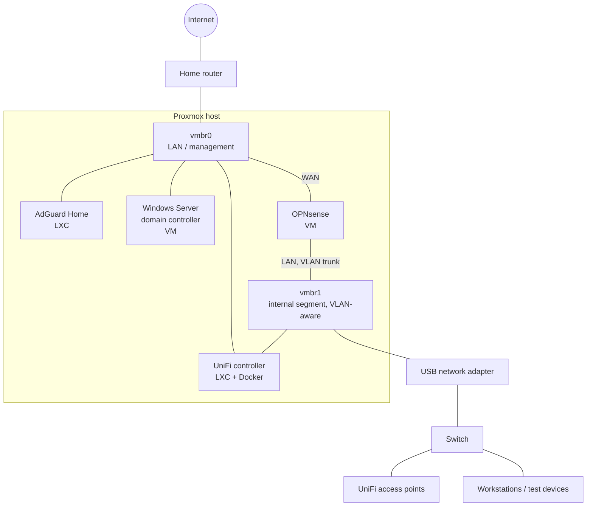

# Homelab Portfolio

🇩🇪 [Deutsche Version](README.md)

My homelab for learning and experimenting: a single virtualization host running a
firewall, DNS filter, Wi-Fi controller and a Windows domain. This repo describes the
setup and the reasoning behind it. All example configs contain placeholders only, no
real values.

## Overview

| Component | Role | Implementation |
|---|---|---|
| Proxmox VE | Hypervisor for all services | Bare metal on a mini PC |
| OPNsense | Firewall and router for the internal segment | VM |
| AdGuard Home | DNS filter for the home network | LXC container |
| UniFi Network Application | Management of the UniFi access points | Docker inside an LXC container |
| Windows Server | Domain controller (Active Directory, DNS) | VM with UEFI and TPM |
| secwatch | Checks BSI advisories against my systems, updates on approval | LXC container, Cloudflare Tunnel |

## Architecture

The host has two bridges:

- **vmbr0** is connected to the home network. It carries management, AdGuard, the
  domain controller and the WAN side of OPNsense.
- **vmbr1** is VLAN-aware and sits on an additional USB network adapter. It hosts an
  internal segment that lies entirely behind OPNsense.

## Why each component?

**Proxmox VE** – Free, based on Debian, and runs both VMs (KVM) and containers (LXC).
Snapshots and backups make it easy to break things and restore them, which is exactly
what a homelab is for.

**OPNsense as firewall** – A real firewall distribution instead of just rules on the
home router. I wanted to learn routing, VLANs, firewall rules and DHCP the way they
appear in corporate networks. As a VM, the firewall can be snapshotted before I change
any rules.

**AdGuard Home** – Blocks ads and tracking via DNS for every device on the network,
without installing anything on the devices. A small LXC container is more than enough.

**UniFi** – The access points need a controller. Instead of dedicated hardware, the
UniFi Network Application runs as a Docker container together with a separate MongoDB
inside an LXC. The container is attached to both bridges so it can reach the devices
in the internal segment.

**Windows Server as domain controller** – I work with Active Directory every day in IT
support. My own DC lets me try out users, groups, GPOs and domain joins safely. The VM
uses UEFI, Secure Boot and a virtual TPM like a real, current server.

## What I learned

- **Networking fundamentals in practice**: bridges, VLAN trunks, separate segments,
  and how a packet travels from a client through the firewall to the internet.
- **VM vs. container**: when a full VM is required (firewall, Windows) and when a
  lightweight LXC container is enough (DNS filter, controller).
- **Docker in LXC**: unprivileged containers need `nesting` and `keyctl` for Docker
  to run inside them.
- **Windows on KVM**: loading VirtIO drivers during setup, UEFI and TPM for current
  Windows versions, QEMU guest agent for clean shutdowns.
- **Separating services**: application and database as separate containers on their
  own internal Docker network; the database is not reachable from outside.
- **Documentation and backups**: keeping configs under version control, encrypting
  sensitive data and publishing only sanitized examples.

## secwatch: handling security advisories automatically

Every day the advisories of the German BSI are matched against the software running
on all systems. If something is affected, a validated update plan arrives by mail and
I approve it from my phone: no open port, snapshot first, automatic rollback.

➡️ [Flow and security design](secwatch/README.en.md)

## Example configs

All values are placeholders (`192.168.X.X`, `example.local`, `<PASSWORD>` etc.).

| File | Contents |
|---|---|
| [`examples/network-interfaces.example`](examples/network-interfaces.example) | Proxmox host networking with two bridges |
| [`examples/lxc-docker.conf.example`](examples/lxc-docker.conf.example) | Unprivileged LXC container with Docker support |
| [`examples/vm-windows-dc.conf.example`](examples/vm-windows-dc.conf.example) | Windows VM with UEFI, TPM and VirtIO |
| [`examples/vm-opnsense.conf.example`](examples/vm-opnsense.conf.example) | Firewall VM with WAN and VLAN trunk |
| [`examples/unifi-compose.example.yml`](examples/unifi-compose.example.yml) | UniFi Network Application with MongoDB |
