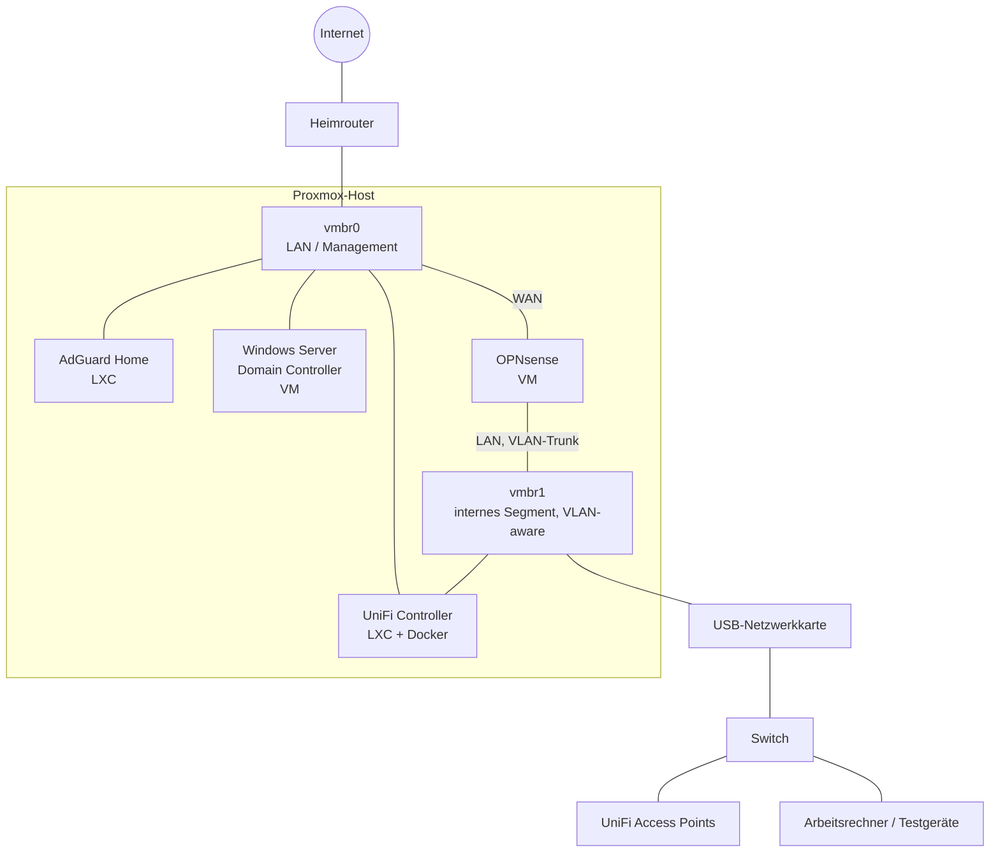

# Homelab-Portfolio

🇬🇧 [English version](README.en.md)

Mein Homelab zum Lernen und Ausprobieren: ein einzelner Virtualisierungs-Host, auf
dem Firewall, DNS-Filter, WLAN-Controller und eine Windows-Domäne laufen. Dieses
Repo beschreibt Aufbau und Entscheidungen. Alle Beispiel-Configs enthalten nur
Platzhalter, keine echten Werte.

## Überblick

| Komponente | Rolle | Umsetzung |
|---|---|---|
| Proxmox VE | Hypervisor für alle Dienste | Bare-Metal auf einem Mini-PC |
| OPNsense | Firewall und Router für das interne Segment | VM |
| AdGuard Home | DNS-Filter für das Heimnetz | LXC-Container |
| UniFi Network Application | Verwaltung der UniFi-Access-Points | Docker in einem LXC-Container |
| Windows Server | Domain Controller (Active Directory, DNS) | VM mit UEFI und TPM |

## Architektur

Der Host hat zwei Bridges:

- **vmbr0** hängt am Heimnetz. Darüber laufen Management, AdGuard, der Domain
  Controller und die WAN-Seite von OPNsense.
- **vmbr1** ist VLAN-aware und liegt auf einer zusätzlichen USB-Netzwerkkarte.
  Hier hängt ein internes Segment, das komplett hinter OPNsense liegt.

## Warum welche Komponente?

**Proxmox VE** – Kostenlos, basiert auf Debian und kann sowohl VMs (KVM) als auch
Container (LXC) betreiben. Snapshots und Backups machen es leicht, Dinge kaputt zu
machen und wiederherzustellen, und genau dafür ist ein Homelab da.

**OPNsense als Firewall** – Eine echte Firewall-Distribution statt nur Regeln auf dem
Heimrouter. Ich wollte Routing, VLANs, Firewall-Regeln und DHCP so lernen, wie sie
auch in Firmennetzen vorkommen. Als VM lässt sich die Firewall per Snapshot sichern,
bevor ich Regeln ändere.

**AdGuard Home** – Filtert Werbung und Tracking per DNS für alle Geräte im Netz, ohne
dass auf den Geräten etwas installiert werden muss. Ein schlanker LXC-Container
reicht dafür völlig aus.

**UniFi** – Die Access Points brauchen einen Controller. Statt einer eigenen Hardware
läuft die UniFi Network Application als Docker-Container zusammen mit einer
separaten MongoDB in einem LXC. Der Container hängt an beiden Bridges, damit er die
Geräte im internen Segment erreicht.

**Windows Server als Domain Controller** – Im IT-Support arbeite ich täglich mit
Active Directory. Ein eigener DC erlaubt es, Benutzer, Gruppen, GPOs und
Domänenbeitritte gefahrlos auszuprobieren. Die VM nutzt UEFI, Secure Boot und ein
virtuelles TPM wie ein echter, aktueller Server.

## Was ich gelernt habe

- **Netzwerk-Grundlagen praktisch**: Bridges, VLAN-Trunks, getrennte Segmente und
  wie ein Paket vom Client über die Firewall ins Internet kommt.
- **VM vs. Container**: Wann eine volle VM nötig ist (Firewall, Windows) und wann
  ein leichter LXC-Container reicht (DNS-Filter, Controller).
- **Docker in LXC**: Unprivilegierte Container brauchen `nesting` und `keyctl`, damit
  Docker darin läuft.
- **Windows unter KVM**: VirtIO-Treiber beim Setup einbinden, UEFI und TPM für
  aktuelle Windows-Versionen, QEMU Guest Agent für sauberes Herunterfahren.
- **Dienste trennen**: Anwendung und Datenbank als getrennte Container mit eigenem
  internen Docker-Netz, die Datenbank ist von außen nicht erreichbar.
- **Dokumentation und Sicherung**: Configs versioniert ablegen, sensible Daten
  verschlüsselt halten und für die Öffentlichkeit nur bereinigte Beispiele zeigen.

## Beispiel-Configs

Alle Werte sind Platzhalter (`192.168.X.X`, `example.local`, `<PASSWORT>` usw.).

| Datei | Inhalt |
|---|---|
| [`examples/network-interfaces.example`](examples/network-interfaces.example) | Netzwerk des Proxmox-Hosts mit zwei Bridges |
| [`examples/lxc-docker.conf.example`](examples/lxc-docker.conf.example) | Unprivilegierter LXC-Container mit Docker-Unterstützung |
| [`examples/vm-windows-dc.conf.example`](examples/vm-windows-dc.conf.example) | Windows-VM mit UEFI, TPM und VirtIO |
| [`examples/vm-opnsense.conf.example`](examples/vm-opnsense.conf.example) | Firewall-VM mit WAN und VLAN-Trunk |
| [`examples/unifi-compose.example.yml`](examples/unifi-compose.example.yml) | UniFi Network Application mit MongoDB |
