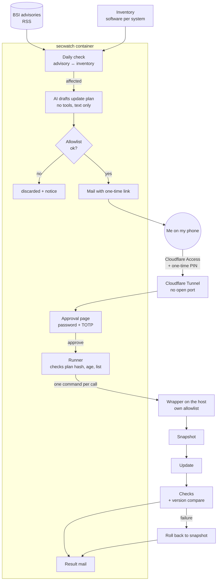

# secwatch: automatic BSI advisory checks and approved patching

🇩🇪 [Deutsche Version](README.md)

When a major vulnerability goes public, every hour counts. I didn't want to rely
on stumbling across an advisory by chance. secwatch checks the advisories of the
German Federal Office for Information Security (BSI, WID / CERT-Bund) every day
against the actual software versions in my homelab. If a system is affected, I get
a ready-made update plan by mail and can approve it with one click, even from my
phone.

The code itself stays private. This page describes the flow, the security design
and what I learned. All names, addresses and IDs are placeholders.

## Flow

1. **Inventory:** A restricted account regularly reads which packages and versions
   run on the host, the firewall and the containers.
2. **Matching:** New advisories are compared with the inventory. For the host, an
   advisory only counts if a package update actually exists.
3. **Plan:** For each affected system an AI writes an update plan as JSON. It gets
   the advisory as plain data and has **no tools**, so it cannot execute anything.
4. **Allowlist:** Every command must fully match a fixed pattern; shell characters
   are rejected outright.
5. **Mail + approval:** The link works once and for 24 hours. The page is not
   exposed directly but only via a Cloudflare Tunnel with a login in front, followed
   by password and TOTP.
6. **Execution:** Only after approval, command by command through a wrapper on the
   host. Snapshot first, checks afterwards.
7. **Report:** The result arrives by mail. If the host needs a reboot, that is a
   separate plan with its own approval.

## Security design

| Risk | Mitigation |
|---|---|
| A crafted advisory tries to talk the AI into something malicious (prompt injection) | AI without tools, advisory as data only, plan must pass the allowlist. In testing an injected instruction was ignored and flagged. |
| Approval page attacked from the internet | No open port on the router. Access only via Cloudflare Tunnel + Access (one-time PIN to a single address), then password (argon2id) and TOTP. |
| Link intercepted or plan changed afterwards | One-time link with expiry, only its hash is stored. The decision contains the SHA-256 of the plan I saw; if it no longer matches, nothing runs. |
| Container compromised and used against the host | SSH key restricted to source and a forced command. The wrapper runs exactly one command per call without a shell and checks it against its own copy of the allowlist. |
| Update breaks the firewall | Snapshot first, then a watchdog checks from inside whether internet comes back. If not: automatic rollback. |
| Update fails silently | Version compare before/after. If the firmware reports an error and the version is unchanged, the plan counts as failed. |
| Mails reveal network details | A filter strips IP addresses and hostnames before sending. |
| Credentials on disk | No plaintext files: secrets are stored encrypted as `systemd-creds` and only handed to the service that needs them. |

## Dry run

Before secwatch was allowed to apply real updates, a dry-run mode pushed a fake
advisory through the whole chain; on approval only the checks ran. The advisory
deliberately contained an injected instruction to test the boundary between data
and commands.

## What I learned

- **AI as a tool, not as admin:** The AI suggests; deciding and executing happen
  in other layers, so a wrong or manipulated answer stays harmless.
- **Defense in depth in practice:** Every stage assumes the previous one could be
  compromised.
- **Report failures honestly:** A failed firmware upgrade was initially reported as
  successful. Since then only the version compare counts.
- **Zero trust instead of port forwarding:** A tunnel with login in front is simpler
  and safer than a forwarded port plus VPN.
- **systemd does a lot:** Timers, path units, sandboxing and encrypted credentials
  replace a lot of custom logic.

## Example

[`allowlist.example.py`](allowlist.example.py) shows the allowlist principle with
placeholders.
