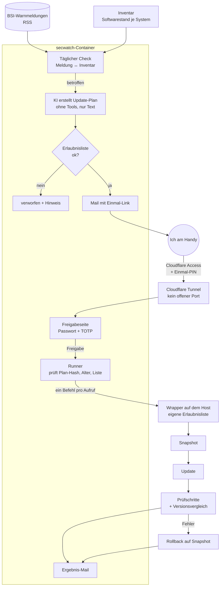

# secwatch: BSI-Warnungen automatisch prüfen und Fixes per Freigabe einspielen

🇬🇧 [English version](README.en.md)

Wenn eine große Sicherheitslücke öffentlich wird, zählt jede Stunde. Ich wollte
nicht mehr darauf angewiesen sein, zufällig eine Meldung zu lesen. secwatch prüft
deshalb jeden Tag die Warnmeldungen des BSI (WID / CERT-Bund) gegen den
tatsächlichen Softwarestand meines Homelabs. Ist ein System betroffen, bekomme ich
einen fertigen Update-Plan per Mail und kann ihn mit einem Klick freigeben, auch
vom Handy und von unterwegs.

Der Code selbst bleibt privat. Hier beschreibe ich Ablauf, Sicherheitskonzept und
was ich dabei gelernt habe. Alle Namen, Adressen und IDs sind Platzhalter.

## Ablauf

1. **Inventar:** Ein eingeschränkter Zugang liest regelmäßig aus, welche Pakete und
   Versionen auf Host, Firewall und Containern laufen.
2. **Abgleich:** Neue BSI-Meldungen werden mit dem Inventar verglichen. Beim Host
   zählt eine Meldung nur, wenn es wirklich ein Paket-Update gibt.
3. **Plan:** Für jedes betroffene System schreibt eine KI einen Update-Plan als JSON.
   Sie bekommt die Meldung nur als Datenblock und hat **keine Tools**, kann also
   nichts selbst ausführen.
4. **Erlaubnisliste:** Jeder Befehl im Plan muss vollständig auf ein festes Muster
   passen, Shell-Zeichen sind gar nicht erst erlaubt. Alles andere wird verworfen.
5. **Mail + Freigabe:** Ich bekomme den Plan per Mail mit einem Link, der nur
   einmal und nur 24 Stunden gilt. Die Seite ist nicht direkt im Internet, sondern
   nur über einen Cloudflare Tunnel mit vorgeschaltetem Login erreichbar. Danach
   kommen noch Passwort und TOTP.
6. **Ausführung:** Erst nach der Freigabe läuft der Plan, Befehl für Befehl über
   einen Wrapper auf dem Host. Vorher wird ein Snapshot angelegt, danach geprüft.
7. **Bericht:** Das Ergebnis kommt wieder per Mail. Braucht der Host einen Neustart,
   gibt es dafür einen eigenen Plan mit eigener Freigabe.

## Sicherheitskonzept

Ein Werkzeug, das Updates einspielen darf, ist selbst ein lohnendes Ziel. Deshalb
hat jede Stufe ihre eigene Grenze:

| Risiko | Gegenmaßnahme |
|---|---|
| Manipulierte Meldung will die KI zu etwas Bösem überreden (Prompt Injection) | KI ohne Tools, Meldung nur als Daten, Plan muss durch die Erlaubnisliste. Im Test wurde eine eingeschleuste Anweisung ignoriert und als verdächtig markiert. |
| Freigabeseite aus dem Internet angreifbar | Kein offener Port am Router. Zugriff nur über Cloudflare Tunnel + Access (Einmal-PIN an eine Adresse), dann Passwort (argon2id) und TOTP. |
| Link abgefangen oder Plan nachträglich geändert | Einmal-Link mit Ablaufzeit, gespeichert wird nur der Hash. Die Entscheidung enthält den SHA-256 des Plans, den ich gesehen habe. Passt er nicht mehr, läuft nichts. |
| Container wird übernommen und greift den Host an | Der SSH-Schlüssel ist auf Absender und einen festen Befehl beschränkt. Der Wrapper führt pro Aufruf genau einen Befehl ohne Shell aus und prüft gegen seine eigene Kopie der Erlaubnisliste, die dem Container nicht gehört. |
| Update legt die Firewall lahm | Snapshot vorher, danach prüft ein Watchdog von innen, ob Internet zurückkommt. Wenn nicht: automatischer Rollback. |
| Update schlägt still fehl | Versionsvergleich vorher/nachher. Bleibt die Version gleich, obwohl die Firmware einen Fehler meldet, gilt der Plan als fehlgeschlagen. |
| Mails verraten zu viel über das Netz | Ein Filter entfernt vor jedem Versand IP-Adressen und Hostnamen. |
| Zugangsdaten auf der Platte | Keine Klartext-Dateien: Secrets liegen verschlüsselt als `systemd-creds` und werden nur dem jeweiligen Dienst bereitgestellt. |

## Testlauf

Bevor secwatch echte Updates einspielen durfte, gab es einen Trockenlauf-Modus:
eine erfundene Meldung durchläuft die ganze Kette, bei der Freigabe laufen aber nur
die Prüfschritte. Darin steckte absichtlich eine eingeschleuste Anweisung, um die
Grenze zwischen Daten und Befehlen zu testen.

## Was ich gelernt habe

- **KI als Werkzeug, nicht als Admin:** Die KI darf Vorschläge machen, entscheiden
  und ausführen tun andere Schichten. So bleibt eine fehlerhafte oder manipulierte
  Antwort harmlos.
- **Defense in Depth praktisch:** Jede Stufe geht davon aus, dass die vorherige
  kompromittiert sein könnte.
- **Fehler ehrlich melden:** Ein gescheitertes Firmware-Upgrade wurde anfangs als
  erfolgreich gemeldet. Seitdem zählt nur, was der Versionsvergleich sagt.
- **Ein Meldetool ist nur so gut wie sein Inventar:** Bei einer großen PHP-Lücke im Oktober 2026 hat secwatch zuerst geschwiegen, weil PHP auf der Firewall gar nicht erfasst war. Gefunden habe ich es beim Nachprüfen von Hand. Seitdem gehört PHP zum Inventar, und das Update lief danach ganz normal als Plan mit Freigabe.
- **Zero Trust statt Portfreigabe:** Ein Tunnel mit vorgeschalteter Anmeldung ist
  einfacher und sicherer als eine Portweiterleitung mit VPN.
- **systemd kann viel:** Timer, Path-Units, Sandboxing und verschlüsselte
  Credentials ersetzen einiges an eigener Logik.

## Beispiel

[`allowlist.example.py`](allowlist.example.py) zeigt das Prinzip der Erlaubnisliste
mit Platzhaltern.
